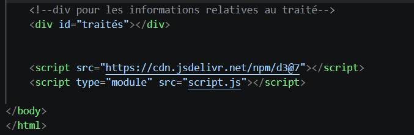
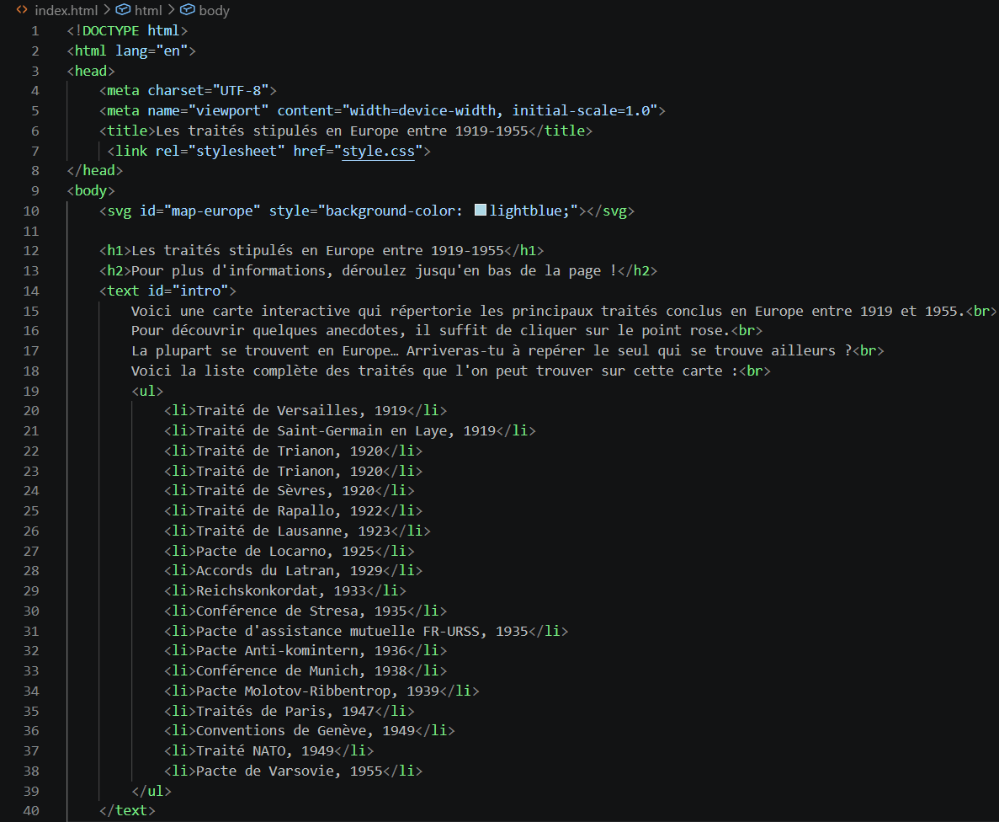
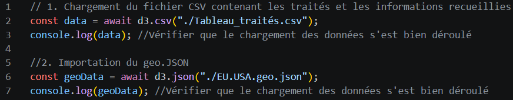
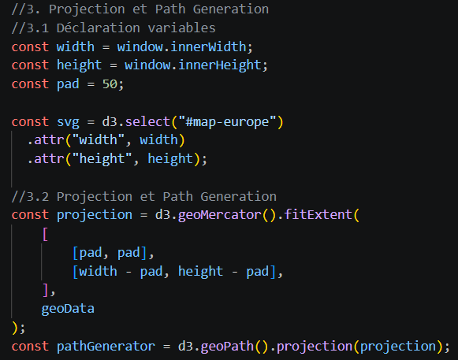
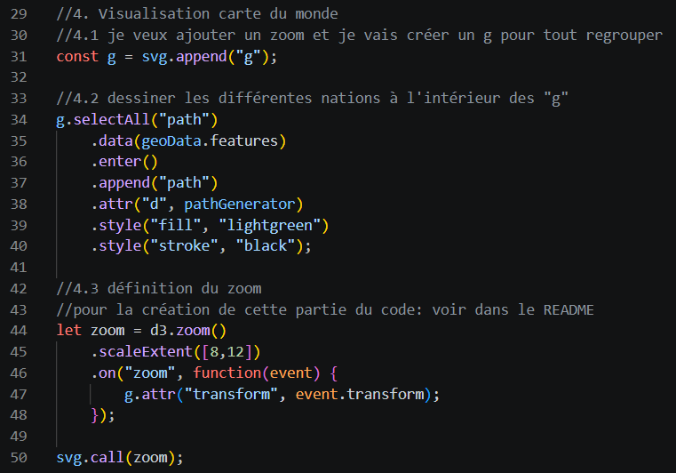
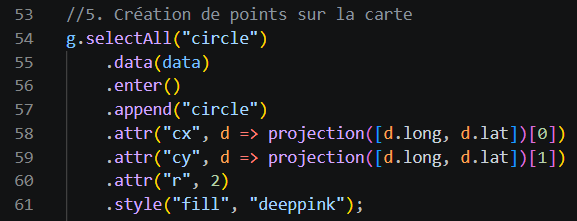
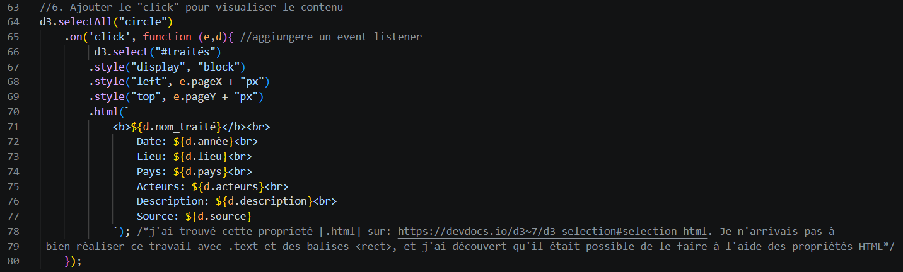
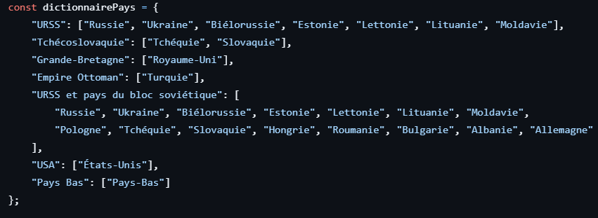
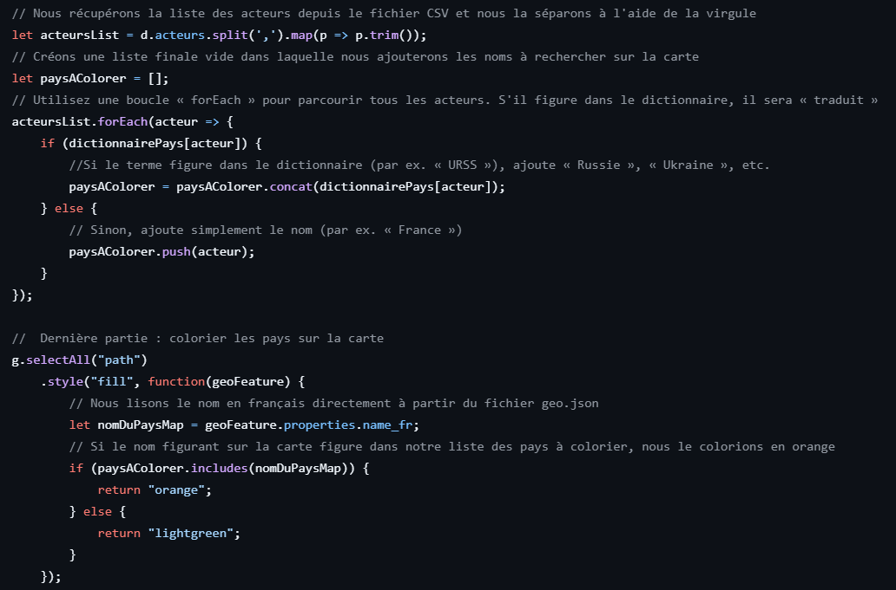
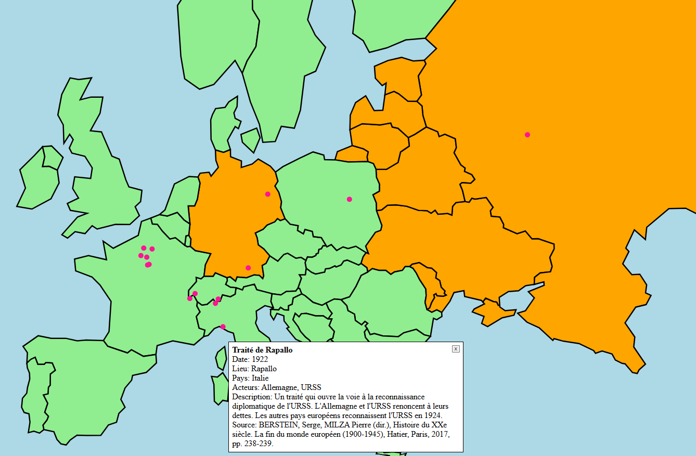

# Cours_VD_SP2026
# Les traités stipulés en Europe entre 1919-1955
L'objectif de ce projet est de représenter sur une carte certains traités qui ont été conclus en Europe entre des États du monde entier. La période prise en compte s'étend de 1919, donc après la fin de la Première Guerre mondiale, à 1955. Cette date marque l'un des points culminants du début de la Guerre froide.
La seule exception concernant un traité non conclu en Europe est celui relatif à la création de l'OTAN (Washington DC, 1949). J'ai décidé de l'intégrer car il concerne la plupart des États européens et constitue l'un des éléments fondamentaux du début de la Guerre froide et de la naissance des deux blocs.
L'idée de ce projet est née de deux centres d'intérêt principaux. Le premier est lié à mon parcours universitaire : j'ai obtenu un bachelor en histoire et en histoire de l'art et je suis particulièrement passionnée par l'histoire contemporaine. La deuxième raison, dans le cadre du cours de visualisation de données, est que j'ai été fascinée par la création d'une carte et que je souhaitais explorer et approfondir ce domaine.
L'objectif de ce projet sera donc de répertorier, sur une carte de l'Europe et de l'Amérique du Nord, une série de traités conclus sur le sol européen. La visualisation permet de localiser des points sur une carte et de découvrir quelques anecdotes sur le traité en question.

## 1. Processus  d'obtention des données 
Le terme « traité » est polysémique ; par conséquent, pour sélectionner les éléments à retenir, j’ai recherché des accords juridiques entre au moins deux États. Il peut s’agir d’accords politiques, internationaux, économiques ou portant sur le partage de territoires. Les deux conditions principales de sélection (à l’exception du traité de l’OTAN) sont le lieu, car les accords doivent donc avoir été conclus sur le continent européen et la participation d’au moins deux États.

Pour recueillir ces données, j’ai utilisé des ouvrages personnels ou recherché des informations sur certaines ressources en ligne. À partir de ces sources, j’ai rassemblé les informations dans un tableau Excel, que j’ai ensuite converti au format CSV en vue de l’importation des données. Vous trouverez ci-dessous une liste répertoriant toutes les sources utilisées: 
- "BERSTEIN, Serge, MILZA Pierre (dir.), *Histoire du XXe siècle. La fin du monde européen (1900-1945)*, Hatier, Paris, 2017".
- "Dodis - Documents diplomatiques suisses, *Le traité de Lausanne (E-dossier)*, consulté le 17.06.2026 (https://www.dodis.ch/fr/le-traite-de-lausanne)."
- "HUBER, Rudolfo, 'Pacte de Locarno' in *Dictionnaire historique de la Suisse (DHS)*, consulté le 17.06.2026 (https://hls-dhs-dss.ch/fr/articles/062308/2025-08-25/)."
- "PALLA, Marco, *Mussolini e il fascismo. L’avvento al potere, il regime, l’eredità politica*, Giunti, Milano, 2019 (1993)."
- "VON PUTTKAMERT, Ellinor, 'Peace Treaties (1947)', in *Oxfort Public International Law*, consulté le 17.06.2026 (https//:opilouplawcomdisplay101093law:epil9780199231690/law-9780199231690-e1979)."
- "s.n., 'Conventions de Genève', in *Département fédéral des affaires étrangères (DFAE)*, consulté le 17.06.2026 (https://www.eda.admin.ch/fr/conventions-de-geneve)."
- "MANTOVANI, Mauro, 'Otan', in *Dictionnaire historique de la Suisse (DHS)*, consulté le 17.06.2026 (https://hls-dhs-dss.ch/fr/articles/041283/2011-10-12/)."
- "CERUTTI, Mauro, 'Pacte de Varsovie', in *Dictionnaire historique de la Suisse*, consulté le 17.06.2026 (https://hls-dhs-dss.ch/fr/articles/041284/2015-01-27/)."

Comme il s'agit d'une carte, un fichier geoJSON est nécessaire pour représenter le monde. Comme je me concentre sur l'Europe et, en partie, sur l'Amérique du Nord, j'ai décidé d'utiliser une carte ne représentant que ces deux régions. Pour ce fichier GeoJSON, nommé [EU.USA.geo.json] dans mon projet, j'ai utilisé ce site : https://geojson-maps.kyd.au/, qui permet de sélectionner uniquement les pays nécessaires ou directement les continents. 

### 1.1 Présentation des données 
Les données collectées peuvent être consultées dans le fichier CSV intitulé [Tableau_traités.csv]. On y trouve les données suivantes: 
1) id : même si cela n'apparaît pas dans l'affichage, j'ai attribué un identifiant à chaque traité, simplement pour mettre de l'ordre dans la liste. 

2) nom_traité : il s'agit du nom du traité. Comme nous l'avons déjà mentionné, le terme « traité » est polysémique ; on trouve donc d'autres appellations telles que « accord », « pacte » ou « conférence ». Il convient de noter que le nom du document reprend souvent le lieu où les parties se sont réunies.

3) année: la date à laquelle l'accord a été signé. Il convient de noter que, souvent, la date peut faire référence à la signature d'un premier document d'accord, mais que l'entrée en vigueur n'intervient qu'après la ratification de ce document. Celle-ci peut en effet avoir lieu ultérieurement, parfois même plusieurs mois plus tard. Dans ce cas, on se réfère à la date de signature de l'accord. 

4) lieu: lieu de la rencontre.

5) pays : pays où la rencontre a eu lieu.

6) acteurs : par « acteurs », on entend tous les pays qui ont signé les documents. Le pays hôte des négociations n'en fait pas nécessairement partie.

7) lat &
8) long : ces deux éléments indiquent le lieu où les négociations ont eu lieu. C'est la ville précise qui sert de référence, et non le pays. Ces deux éléments sont nécessaires pour localiser le lieu le plus précisément possible sur la carte.

9) description: dans cette description, j'ai rassemblé quelques informations sur le contenu du traité et les raisons qui ont poussé les nations à le signer.

10) source : la source où j'ai trouvé ces informations.

### 1.2 Étapes pré-traitement des données 
Comme j'avais créé moi-même le fichier CSV, je n'ai pas eu à effectuer de prétraitements particuliers. Je n'ai dû apporter qu'une seule modification pour que les données fonctionnent. Lorsque j'ai converti la feuille Excel (format .xlsx) en CSV, je ne sais pas pourquoi, mais le fichier comportait trois guillemets (par ex. """TR1""") ; j'ai donc dû supprimer les guillemets superflus et les ajouter lorsque cela était nécessaire, c'est-à-dire dans les textes plus longs et descriptifs.

## 2. Explication de la visualisation produite 
### 2.1 index.html
Pour mon projet, j'ai décidé d'utiliser le script comme module (type="module") afin de pouvoir utiliser await directement pour charger les données, comme on peut le voir dans la première image :     

Le reste du code est visible sur cette image :     
    J'ai décidé de créer directement dans le code HTML le fichier SVG contenant la carte. Cela m'a également permis d'appliquer directement le style via CSS (voir le code). En réalité, j'ai rédigé le texte à l'intérieur de la balise "body" après avoir créé tout le code nécessaire à l'affichage de la carte. J'ai jugé utile d'ajouter directement sur la page le titre du travail ainsi qu'une brève description (introduction) de ce que l'on peut y trouver. J’ai ensuite ajouté une liste de tous les traités répertoriés, afin d’offrir un aperçu général du contenu, que l’on peut ensuite approfondir en consultant les différents cercles. Pour les balises "body", "svg", "h1", "h2" et "#intro", j’ai utilisé des styles CSS (cf. style.css).

### 2.2 script.js
La première étape a consisté à importer les données CSV et GeoJSON :   

À l'étape 3, j'ai procédé à la création des projections et à la génération des chemins :     
    J'ai commencé par déclarer les variables "width" et "height", en les adaptant aux dimensions de l'écran. J'ai ensuite laissé une marge (pad) de 50 pour éviter que la carte ne touche les bords de l'écran. 
    J'ai ensuite sélectionné le SVG (déjà présent dans le code HTML) et je lui ai attribué les dimensions de la fenêtre.
    Avec « const projection = d3.geoMercator().fitExtent (etc.) », j’ai mis en place le système de projection, dans lequel les coordonnées géographiques sont converties en pixels à l’écran. La carte est ainsi adaptée.
    Enfin, on trouve « const pathGenerator = d3.geoPath().projection(projection); », c’est-à-dire l’outil qui transforme les données géographiques du GeoJSON en instructions de dessin SVG. Il utilise la projection pour dessiner chaque point.

Le point 4 correspond à la création d'un groupe "g" au sein du SVG :     
    Ce groupe "g" regroupe tous les éléments de la carte, c'est-à-dire les pays et les cercles (cf. point 5).
    J'ai ensuite procédé au tracé de tous les pays à l'aide de « g.selectAll(« path ») (...) ». Il s'agit d'une jointure de données : geoData.features est le tableau des pays du GeoJSON, dans lequel chaque pays devient un chemin. Le pathGenerator convertit les données géographiques au format SVG et les deux « style » correspondent à la couleur de remplissage et à la couleur de contour.
    Au cours de ces étapes, je me suis rendu compte qu’il serait intéressant et certainement plus interactif d’ajouter un zoom sur la carte, notamment pour mieux voir les cercles (ceux-ci sont créés ultérieurement). Le zoom s’applique à l’ensemble du conteneur "g", ce qui permet de déplacer et de redimensionner l’ensemble en même temps. Pour la création du zoom, j’ai consulté ce site https://d3js.org/d3-zoom et je me suis fait aider par NotebookLM, une IA, pour l’organisation des informations (cette partie du zoom est donc créée avec l’aide de l’IA). <.scaleExtent> limite le zoom entre un minimum de 8x et un maximum de 12x. <.on> est l’événement qui est créé. Ces valeurs ont été choisies afin de permettre une visualisation suffisamment détaillée de l'Europe sans perdre le contexte géographique général. 

Le point numéro 5 consiste à créer des cercles-points pour chaque traité :     
    Les quatre premières lignes de cette partie du code servent à sélectionner tous les cercles du groupe "g", à relier les données du fichier CSV et à créer un cercle pour chaque élément trouvé.
    Comme il s'agit d'une carte, les projections entrent à nouveau en jeu. On récupère les coordonnées géographiques de chaque traité (d.long et d.lat) et on les convertit en pixels. Le "0" prend la coordonnée x et va dans cx, tandis que "1" prend la coordonnée y et va dans cy (car la fonction projection renvoie un tableau [x,y]). 
    J’ai ensuite ajouté quelques attributs, tels que le rayon du cercle et la couleur des cercles. J’ai choisi la couleur « deeppink » pour les cercles afin de créer un meilleur contraste avec le vert des pays. 

Le dernier point, le numéro 6, sert à ajouter un écouteur d'événement à chaque cercle :     
    J'ai choisi comme écouteur d'événement un « clic » et cette fonction s'exécute à chaque fois que l'on clique sur un cercle. 
    Auparavant, j'ai créé un "div" dans le code HTML      car je trouve ce système plus pratique. En le sélectionnant via d3.select(« #traités »).style(“display”, « block »), on le rend visible à l'écran, car dans le CSS, il est masqué par display:none. 
    Ensuite, grâce aux deux « .style », je positionne les "div" à l'endroit où j'ai cliqué sur la carte à l'aide de « e.pageX » et « e.pageY ». Nous avons ensuite « + « px » » car .style() dans D3 définit des propriétés CSS et, pour que le navigateur puisse lire les valeurs de « e.pageX » et « e.pageY », il faut ajouter l’unité px (pixel).
    Enfin, j’ai trouvé la propriété « .html » sur https://devdocs.io/d3~7/d3-selection#selection_html, qui me permet d’insérer du code HTML formaté à l’intérieur de "div". J’ai utilisé « ${} » pour insérer des variables dans la chaîne de caractères et j’ai sélectionné chaque colonne du fichier CSV pour importer les données via d.nom_traité, d.année, d.lieu, etc.

Une fois tout cela terminé, j'ai essayé de régler deux derniers détails. Le premier concerne la taille des cercles et leur rayon, car ils étaient trop grands et ne me plaisaient pas. La deuxième modification concerne l'ajustement de certaines coordonnées. 
    Comme on peut le voir sur le fichier CSV ou sur la carte, il y a plusieurs cercles dans la région de Paris : certains se chevauchaient complètement (les traités ayant été signés à Paris) et d'autres ont été conclus dans les environs de la capitale française. J'ai donc modifié manuellement les coordonnées de ces traités pour les espacer davantage. J’ai cherché sur Internet des solutions pour espacer les cercles, mais elles me semblaient un peu trop compliquées pour mes compétences très basiques. 
    Dans le cas des deux traités signés au Vatican (cf. fichier CSV ou carte), j’ai procédé de la même manière : j’ai espacé manuellement les points afin de rendre les cercles plus visibles.

Cette partie 6 a ensuite été modifiée afin de rendre la carte plus interactive. Une commande a été ajoutée pour permettre de fermer la fenêtre dans laquelle s'affichent les informations relatives au traité, via la fonction  <button style="position: absolute; right: 10px; top: 10px; cursor: pointer;" onclick="this.parentNode.style.display=“none”">X</button>. Il est en effet intéressant d’utiliser la balise HTML pour ajouter directement cette fonctionnalité.
Le reste du code a pour objectif suivant : en cliquant sur le point rose, les pays ayant signé ce traité changent de couleur.
    Dans un premier temps, j’ai dû adapter certains noms de traités par rapport à ce qui figurait dans le document GeoJSON. J’ai moi-même pris conscience des problèmes de traduction potentiels et j’ai demandé conseil à Gemini sur la manière d’écrire correctement les noms des pays.     
    Ensuite, pour la partie concernant la boucle ForEach, je me suis presque entièrement aidée de l’IA (Gemini).     
En général, le principe m’était clair, mais le transposer en code était un peu trop difficile pour moi. Le processus est le suivant : après avoir sélectionné les pays et associé les acteurs, ces derniers sont colorés en orange lorsque l’on clique sur le point rose, comme on peut le voir dans l’exemple suivant :
       
On obtient ainsi une carte encore plus interactive.

La partie désormais intitulée 6.3 correspond au code décrit précédemment.

## 3. Conclusion: limites et perspectives
Avec ce projet, j'ai cherché à explorer le fonctionnement de la création de cartes à l'aide de D3. J'ai trouvé l'ensemble du processus très intéressant et le fait de développer un projet personnel m'a permis de mieux comprendre la logique de fonctionnement de D3, en particulier la création de SVG et d'éléments (tels que les cercles), mais aussi de commencer à appréhender le caractère dynamique des données.
J’ai également cherché à approfondir ce que j’avais vu pendant le cours en recherchant d’autres fonctionnalités sur des blogs ou d’autres sites. Cela m’a également permis d’explorer davantage le potentiel de cette bibliothèque. 
Néanmoins, je me rends compte que certains éléments pourraient être mieux mis en œuvre. Par exemple, le clic qui ouvre le "div" contenant les informations sur le traité ne se ferme pas si je clique sur un autre endroit de la page. Je n’arrivais pas à résoudre ce problème par moi-même et je ne voulais pas non plus recourir à l’intelligence artificielle pour cela. 
J’aurais peut-être pu ajouter quelques traités supplémentaires, mais, comme j’ai moi-même collecté les données et rédigé les descriptions, le travail aurait été plus long et plus exigeant, et j’aurais dû modifier la périodisation.
Pour améliorer le projet, on pourrait donc envisager d’étendre la périodisation et peut-être inclure d’autres continents.

